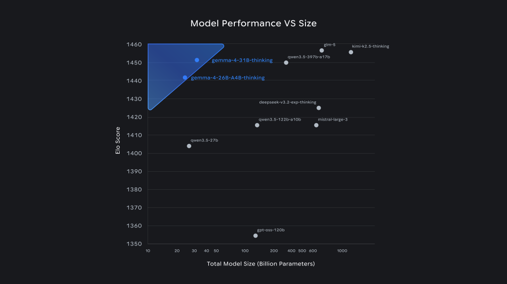

# One GPU, 3.5× Faster: Tuning Gemma-4-31B-it with vLLM

Google's [Gemma 4](https://arxiv.org/abs/2607.02770) family is one of the strongest open model releases so far. The largest dense model, **Gemma-4-31B-it**, ranks as the top open dense model on the Arena text leaderboard (Elo 1451). It comes under the Apache 2.0 license, so you can run it, fine-tune it, and ship it however you like.



*Arena text Elo vs. model size. Source: [Google DeepMind, Gemma 4](https://deepmind.google/models/gemma/gemma-4/).*

We've been running it in production for a multilingual workload with long documents, many of them in Indic languages. Before getting into the tuning, here's what makes the model worth the effort.

## Meet Gemma-4-31B-it

**Advanced reasoning.** Gemma 4 has a built-in *thinking mode*. Turn it on, and the model writes out a reasoning trace before it answers. With thinking enabled, the 31B model scores:

| Benchmark | What it tests | Score |
|---|---|---|
| MMLU Pro | Broad knowledge and reasoning | 85.2 |
| GPQA Diamond | Graduate-level science | 84.3 |
| AIME 2026 (no tools) | Competition math | 89.2 |
| LiveCodeBench v6 | Coding | 80.0 |
| MMMLU | Multilingual knowledge | 88.4 |
| IFEval | Instruction following | 98.9 |

**Built-in speculative decoding (MTP).** Google also ships a small **multi-token prediction (MTP) drafter** with Gemma 4. It's a 4-layer, ~500M-parameter model that reuses the main model's KV cache to guess several tokens ahead. vLLM supports it directly, and in Step 5 below it gives us **+45% throughput** on its own.

**Efficient long-context design.** Most layers use local sliding-window attention, with one global-attention layer for every five local ones. Global layers also reuse keys as values. Together, these cut the global KV cache by up to 37.5%, which matters a lot when you serve 16K-token prompts on a single GPU.

**Ready for agents.** Native function calling and tool use are built in. The 31B model scores 75.0 / 86.4 / 69.3 on the Tau2 airline / retail / telecom agent benchmarks.

*All numbers above come from the [Gemma 4 Technical Report](https://arxiv.org/abs/2607.02770).*

**The catch:** a 31B dense model is heavy. In bf16, the weights alone take about 64 GB. Out of the box, our vLLM server managed only **~1,600 tokens/sec**, and users waited **~40 seconds** for the first token. This post shows how we got that to **5,555 tokens/sec** and **3.8 seconds** on a single NVIDIA RTX PRO 6000.

## Why an open model instead of a managed API

**1. Nobody can retire it on you.** A model you host keeps running until *you* decide to change it. Managed APIs don't make that promise. For example, Gemini-2.5-Flash has been deprecated and removed from Google AI Studio, and from **December 1, 2026**, its API calls will be routed to Gemini-3.5-Flash-Lite and billed at Flash-Lite rates.

**2. You can fine-tune it.** Gemma's weights are open, so we can fine-tune it on our own data and own the result. Gemini is a closed API model.

**3. Your data stays private.** The model runs in our own GKE cluster, so no prompt leaves our VPC.

**4. It's much cheaper at steady load.** Gemini-3.5-Flash costs **\$1.50 per million input tokens** and **\$9.00 per million output tokens**, which is 5× and 3.6× Gemini-2.5-Flash's prices. After tuning, one GPU handles 14.4B tokens/month (running 24/7) for a flat monthly price:

| | Monthly cost | Per 1M tokens |
|---|---|---|
| Gemini-3.5-Flash | ~\$24,870 | ~\$1.73 |
| Gemini-2.5-Flash (retiring) | ~\$5,280 | ~\$0.37 |
| **Gemma-4-31B-it on 1× RTX PRO 6000** | **~\$3,000** (flat) | **~\$0.21** |

That's **about 8.3× cheaper than Gemini-3.5-Flash**, and still about 1.8× cheaper than Gemini-2.5-Flash pricing. The full breakdown is further down.

### Why Gemma-4-31B-it and not another open model?

Before choosing Gemma-4-31B-it, we evaluated three similar-sized open models: two Mixture-of-Experts (MoE) models, **Gemma-4-26B-A4B-it** and **Qwen-3.6-35B-A3B**, and one dense model, **Qwen3.8-27B**.

- **Dense vs. MoE:** An MoE model activates only a small part of its weights for each token. For example, "A4B" means about 4B active parameters out of 26B. That makes MoE models fast and cheap, but each token gets less of the model's capacity. A dense model like Gemma-4-31B-it uses **all 31B parameters for every token**, which helps on harder tasks that need more nuance.
- **Gemma vs. Qwen dense:** Qwen3.8-27B is also dense and close in size, so the difference there comes from the training data rather than the architecture. Gemma's broad multilingual training gives it the edge on Indic languages.
- **Multilingual and Indic language understanding:** Our use case involves multiple languages, especially Indic languages. In our internal evaluations, **Gemma-4-31B-it beat all three models by a clear margin** and came **close to Gemini-2.5-Flash accuracy**.

<!-- Optional: add your eval scores here
| Model | Type | Active params | Indic eval accuracy | Multilingual eval accuracy |
|---|---|---|---|---|
| Gemini-2.5-Flash | Closed API | — | xx% | xx% |
| **Gemma-4-31B-it** | Dense | 31B | **xx%** | **xx%** |
| Qwen3.8-27B | Dense | 27B | xx% | xx% |
| Gemma-4-26B-A4B-it | MoE | ~4B | xx% | xx% |
| Qwen-3.6-35B-A3B | MoE | ~3B | xx% | xx% |
-->

**The trade-off:** a dense 31B model is much slower to serve than a 3–4B-active MoE model, because every token reads all 31B weights. That's exactly why the rest of this post focuses on optimization: we wanted dense-model accuracy at a cost that still beats a managed API.

### Cost breakdown: self-hosted Gemma vs. Gemini

**Pricing used (per 1M tokens):**

| | Input | Output |
|---|---|---|
| Gemini-2.5-Flash (retiring) | \$0.30 | \$2.50 |
| Gemini-3.5-Flash | \$1.50 | \$9.00 |
| RTX PRO 6000 server | ~\$3,000/month flat, no limit on tokens | |

Gemini output prices include thinking tokens.

**Assumptions:** the server runs our benchmark workload (16K input / 512 output per request) at full load around the clock for a 30-day month. That's 2,592,000 seconds.

| | Baseline vLLM | Optimized vLLM |
|---|---|---|
| Input tokens / month | 4.01 B | 13.96 B |
| Output tokens / month | 0.13 B | 0.44 B |
| **Self-hosted cost** | \$3,000 | \$3,000 |
| **Self-hosted cost per 1M tokens** | \$0.73 | **\$0.21** |
| Gemini-2.5-Flash cost for the same tokens | \$1,516 | \$5,279 |
| Gemini-3.5-Flash cost for the same tokens | \$7,143 | \$24,868 |
| **vs. Gemini-2.5-Flash** | 2× more expensive | **1.8× cheaper** |
| **vs. Gemini-3.5-Flash** | 2.4× cheaper | **8.3× cheaper** (saves ~\$21,900/month) |

**The tuning is what makes the numbers work.** With vLLM's default settings, self-hosting would have cost about twice as much as Gemini-2.5-Flash. After tuning, it beats even that.

> **Caveat:** The server costs the same whether it's busy or idle, while Gemini charges only for tokens you use. For our optimized setup, the break-even point against Gemini-3.5-Flash is only about **12% average utilization** (\$3,000 ÷ \$24,868), and about 57% against Gemini-2.5-Flash pricing. Our workload is also mostly input tokens. Output-heavy workloads tilt further in favor of self-hosting, because output tokens are the expensive part of Gemini's pricing.

## The results at a glance

Here's where we ended up. We started from a default vLLM setup serving Gemma-4-31B-it on one NVIDIA RTX PRO 6000 (Blackwell, 96 GB). By changing seven settings one at a time, we raised total throughput from **1,596 to 5,555 tokens/sec (3.48×)** and cut mean time-to-first-token (TTFT) from **39.6 s to 3.8 s (−90%)**. All 100 requests succeeded in every run.

| Step | Change | Throughput (tok/s) | Mean TTFT | Mean TPOT | Mean ITL | Verdict |
|---|---|---|---|---|---|---|
| 0 | Baseline (defaults, 32K context) | 1,596 | 39.6 s | 82.6 ms | 84.7 ms | — |
| 1 | `--max-model-len 20480` | 1,812 (+14%) | 31.7 s (−20%) | 82.0 ms (−1%) | 83.9 ms (−1%) | ✅ Keep |
| 2 | `--gpu-memory-utilization 0.95` | 2,056 (+13%) | 13.3 s (−58%) | 99.8 ms (+22%) | 102.4 ms (+22%) | ✅ Keep |
| 3 | `--kv-cache-dtype fp8` | 2,547 (+24%) | 8.4 s (−37%) | 85.6 ms (−14%) | 87.7 ms (−14%) | ✅ Keep |
| 4 | `--max-num-seqs` / `--max-num-batched-tokens` | 2,545 (0%) | 8.4 s (0%) | 85.6 ms (0%) | 87.7 ms (0%) | ➖ No effect |
| 5 | Speculative decoding (MTP, 4 tokens) | 3,695 (+45%) | 6.0 s (−29%) | 59.5 ms (−30%) | 209.8 ms (+139%) | ✅ Keep |
| 6 | `--attention-backend FLASHINFER` | 3,713 (+0.5%) | 5.2 s (−14%) | 60.0 ms (+1%) | 204.2 ms (−3%) | ➖ Optional |
| 7 | `--quantization fp8` | **5,555 (+50%)** | **3.8 s (−26%)** | **39.7 ms (−34%)** | 137.1 ms (−33%) | ✅ Keep if ~1% accuracy loss is OK |

The rest of this post walks through each step: what the setting does, why it helps, and what it did to our numbers.

---

## Setup

We run vLLM inside a GKE cluster on a node pool with one RTX PRO 6000 GPU:

```bash
gcloud beta container node-pools create ...
```

### Workload profile

Every benchmark below uses the same workload, sized to match our production use case:

- **Input:** 16,384 tokens per request
- **Output:** 512 tokens per request
- **Concurrency:** 8 requests in flight
- **Total:** 100 prompts

> This is a **long-input, short-output** workload, so most of the GPU's work is prefill (reading the prompt). Your results will differ if your workload looks different. Change the benchmark parameters to match your own traffic.

### Baseline deployment

Gemma-4-31B-it supports a 256K context window by default, but its KV cache won't fit on a single RTX PRO 6000 at that length. We start with 32K and leave every other setting at vLLM's defaults.

`deploy.yaml` (trimmed to the relevant part):

```yaml
apiVersion: apps/v1
kind: Deployment
metadata:
  name: text-llm-server
  namespace: dev-vllm
spec:
  template:
    spec:
      containers:
        - name: vllm
          args:
            - >
              vllm serve
              --host 0.0.0.0
              --port 8080
              --model /models/gemma-4-31B-it
              --served-model-name gemma-4-31B-it
              --enable-prefix-caching
              --enable-chunked-prefill
              --enable-auto-tool-choice
              --async-scheduling
              --language-model-only
              --tool-call-parser gemma4
              --chat-template examples/tool_chat_template_gemma4.jinja
              --reasoning-parser gemma4
              --trust-remote-code
              --max-model-len 32768
```

#### What the baseline flags do

| Flag | What it does |
|---|---|
| `--enable-prefix-caching` | Reuses the KV cache for prompt prefixes that requests share, such as the same system prompt, so they aren't computed again. |
| `--enable-chunked-prefill` | Splits long prompts into chunks and runs them alongside decode steps, so a 16K-token prompt doesn't stall token generation for other users. |
| `--async-scheduling` | Schedules the next batch on the CPU while the GPU is still running the current one, which hides scheduler overhead. |
| `--language-model-only` | Skips loading Gemma 4's vision/audio encoders, which saves GPU memory for a text-only workload. |
| `--enable-auto-tool-choice`, `--tool-call-parser gemma4`, `--chat-template ...` | Turn on OpenAI-compatible function calling with Gemma 4's tool format. |
| `--reasoning-parser gemma4` | Splits the model's "thinking" output from the final answer in API responses. |

Deploy it and wait for the pod to become ready, which takes about 5 minutes while the weights load:

```bash
kubectl apply -f deploy.yaml
kubectl -n dev-vllm get pod -w
kubectl -n dev-vllm logs -f <pod-name>
```

One line in the startup log is worth pointing out:

```
Gemma4 model has heterogeneous head dimensions {'sliding_attention': 256, 'full_attention': 512}.
FA4 not available, forcing TRITON_ATTN backend.
```

Gemma 4 uses two different attention head sizes. The FlashAttention-4 kernels can't handle that combination on this GPU, so vLLM falls back to the slower Triton attention backend. We revisit this in Step 6.

### Running the benchmark

We use vLLM's built-in benchmark tool from inside the pod:

```bash
kubectl -n dev-vllm exec -it <pod-name> -- bash

vllm bench serve \
  --model /models/gemma-4-31B-it \
  --served-model-name gemma-4-31B-it \
  --backend openai-chat \
  --base-url http://localhost:8080 \
  --endpoint /v1/chat/completions \
  --random-input-len 16384 \
  --random-output-len 512 \
  --max-concurrency 8 \
  --num-prompts 100
```

### Baseline results

```
============ Serving Benchmark Result ============
Successful requests:                     100
Benchmark duration (s):                  1059.78
Total token throughput (tok/s):          1595.56
Output token throughput (tok/s):         48.31
---------------Time to First Token----------------
Mean TTFT (ms):                          39638.24
Median TTFT (ms):                        46601.69
P99 TTFT (ms):                           55015.58
-----Time per Output Token (excl. 1st token)------
Mean TPOT (ms):                          82.59
---------------Inter-token Latency----------------
Mean ITL (ms):                           84.69
==================================================
```

**1,596 tokens/sec, and users wait almost 40 seconds for the first token.** We can do much better.

> **Reading the metrics**
> - **Total token throughput:** input + output tokens processed per second. Higher is better.
> - **TTFT (Time To First Token):** how long a user waits before the response starts. Lower is better.
> - **TPOT (Time Per Output Token):** how fast tokens stream once generation starts. Lower is better.
> - **ITL (Inter-Token Latency):** the gap between consecutive streamed chunks the client receives. Lower is better.

---

## Step 1: Shrink the context window to what you actually need

**What it does:** `--max-model-len` sets the longest sequence (prompt + output) the server will accept. Our requests never go over 16,384 + 512 = 16,896 tokens, so we set it to **20,480** to leave some headroom.

**Why it helps:** vLLM sizes some of its memory reservations around the worst-case sequence length. A smaller limit leaves more GPU memory for the KV cache, so more requests fit on the GPU at once and fewer wait in the queue.

```diff
- --max-model-len 32768
+ --max-model-len 20480
```

| Metric | Before | After | Change |
|---|---|---|---|
| Throughput (tok/s) | 1,596 | 1,812 | **+14%** |
| Mean TTFT | 39.6 s | 31.7 s | **−20%** |
| Mean TPOT | 82.6 ms | 82.0 ms | −1% |
| Mean ITL | 84.7 ms | 83.9 ms | −1% |

---

## Step 2: Give vLLM more GPU memory

Here's `nvidia-smi` during the previous run:

```
| NVIDIA RTX PRO 6000 Blac...  | 578W / 600W | 88601MiB / 97887MiB | 100% |
```

vLLM's default memory budget is 90% of the GPU, which leaves about 9 GB unused.

**What it does:** `--gpu-memory-utilization` sets the fraction of GPU memory vLLM may use for model weights, activations, and the KV cache. Raising it to **0.95** gives that extra memory to the KV cache.

**Why it helps:** More KV cache lets more 16K-token prompts sit on the GPU at the same time, so requests spend less time queued. That's why TTFT drops so sharply. Keep a little headroom, because setting it too close to 1.0 can cause out-of-memory errors.

```diff
+ --gpu-memory-utilization 0.95
```

| Metric | Before | After | Change |
|---|---|---|---|
| Throughput (tok/s) | 1,812 | 2,056 | **+13%** |
| Mean TTFT | 31.7 s | 13.3 s | **−58%** |
| Mean TPOT | 82.0 ms | 99.8 ms | +22% |
| Mean ITL | 83.9 ms | 102.4 ms | +22% |

> With more requests decoding at once, each token takes slightly longer (higher TPOT). For this prefill-heavy workload, that's a good trade.

---

## Step 3: Store the KV cache in FP8

**What it does:** `--kv-cache-dtype fp8` stores the attention key/value cache in 8-bit floats instead of the model's 16-bit `bfloat16`. The model weights themselves stay in `bfloat16`.

**Why it helps:** Each cached token takes **half the memory**, so the KV cache holds about twice as many tokens and the attention kernels read half as many bytes. Blackwell GPUs support FP8 in hardware, and the effect on quality is usually negligible.

```diff
+ --dtype bfloat16          # default, listed for clarity
+ --kv-cache-dtype fp8
```

| Metric | Before | After | Change |
|---|---|---|---|
| Throughput (tok/s) | 2,056 | 2,547 | **+24%** |
| Mean TTFT | 13.3 s | 8.4 s | **−37%** |
| Mean TPOT | 99.8 ms | 85.6 ms | **−14%** |
| Mean ITL | 102.4 ms | 87.7 ms | **−14%** |

---

## Step 4: Tune batching (no gain this time)

vLLM uses **continuous batching**: new requests join the running batch at every step instead of waiting for a whole batch to finish. Two settings control how big that batch can get:

- **`--max-num-seqs`:** the maximum number of requests processed together in one step. A higher value allows more parallelism but needs more memory.
- **`--max-num-batched-tokens`:** the maximum number of tokens (prefill chunks + decode tokens) processed in one step. Larger chunks keep the GPU busier during prefill but can slow down decoding for other requests.

```diff
+ --max-num-seqs 16
+ --max-num-batched-tokens 8192
```

| Metric | Before | After | Change |
|---|---|---|---|
| Throughput (tok/s) | 2,547 | 2,545 | 0% |
| Mean TTFT | 8.4 s | 8.4 s | 0% |
| Mean TPOT | 85.6 ms | 85.6 ms | 0% |
| Mean ITL | 87.7 ms | 87.7 ms | 0% |

**Why there was no change:** The startup log shows `max_num_batched_tokens=8192` was already the default, and our benchmark never sends more than 8 requests at a time, so allowing 16 sequences has no effect. We also tried `--max-num-seqs 32 --max-num-batched-tokens 16384` and saw no improvement. These settings matter more at higher concurrency.

---

## Step 5: Speculative decoding 🚀

**What it does:** [Speculative decoding](https://arxiv.org/abs/2302.01318) uses a small, fast "draft" model to guess the next few tokens. The large model then checks all of those guesses in a **single** forward pass, so every correct guess is a token we get without a separate pass of the 31B model.

**Why it helps:** Decoding is limited by memory bandwidth, because each token requires reading all 31B parameters. Checking 4 guesses costs about the same as generating 1 token. Here we use Gemma's assistant model as the MTP (multi-token prediction) drafter, proposing 4 tokens at a time.

```diff
+ --speculative-config '{"method":"mtp", "model":"/models/google__gemma-4-31b-it-assistant", "num_speculative_tokens":4}'
```

| Metric | Before | After | Change |
|---|---|---|---|
| Throughput (tok/s) | 2,547 | 3,695 | **+45%** |
| Mean TTFT | 8.4 s | 6.0 s | **−29%** |
| Mean TPOT | 85.6 ms | 59.5 ms | **−30%** |
| Mean ITL | 87.7 ms | 209.8 ms | +139%* |

\* *Higher mean ITL is expected here. With speculative decoding, each streamed chunk contains several tokens, so the gaps between chunks get longer even though tokens are generated faster overall (TPOT −30%).*

**How good were the guesses?**

```
Acceptance rate (%):          62.90
Acceptance length:            3.52    # avg tokens produced per verification step
Per-position acceptance (%):  82.6 → 67.0 → 55.1 → 46.9
```

On average, each verification step of the large model produces **3.5 tokens instead of 1**. Acceptance drops for later positions in the guess, so you can also try `num_speculative_tokens` = 2 or 3. For our workload, 4 worked best.

---

## Step 6: Try the FlashInfer attention backend

Remember the startup warning: FA4 isn't available, so vLLM falls back to Triton attention. Let's try FlashInfer instead.

**What it does:** `--attention-backend` chooses which kernel library computes attention. **FlashInfer** provides optimized kernels for both prefill and decode, with good support for paged and FP8 KV caches.

**Why it might help:** Attention takes a large share of the work for 16K-token prompts, so a faster kernel mainly shortens prefill, which shows up as lower TTFT.

```diff
+ --attention-backend FLASHINFER
```

| Metric | Before | After | Change |
|---|---|---|---|
| Throughput (tok/s) | 3,695 | 3,713 | +0.5% |
| Mean TTFT | 6.0 s | 5.2 s | −14% |
| Mean TPOT | 59.5 ms | 60.0 ms | +1% |
| Mean ITL | 209.8 ms | 204.2 ms | −3% |

TTFT improved somewhat, but throughput stayed flat. Keep this setting if TTFT matters to you, but benchmark it on your own workload before deciding.

---

## Step 7: FP8 weight quantization (the biggest single win)

**What it does:** `--quantization fp8` converts the model weights from 16-bit to 8-bit floats when the model loads. No separate pre-quantized checkpoint is needed.

**Why it helps:** The weights shrink from about 64 GB to about 32 GB. That **halves the memory read for every decoded token**, lets Blackwell's FP8 Tensor Cores do the matrix math, and frees roughly 30 GB more for the KV cache.

**The trade-off:** accuracy. On our internal evaluation set, quality dropped by **about 1%**, which is acceptable for our use case. Run your own evals before turning this on.

```diff
+ --quantization fp8
```

| Metric | Before | After | Change |
|---|---|---|---|
| Throughput (tok/s) | 3,713 | **5,555** | **+50%** |
| Mean TTFT | 5.2 s | **3.8 s** | **−26%** |
| Mean TPOT | 60.0 ms | **39.7 ms** | **−34%** |
| Mean ITL | 204.2 ms | **137.1 ms** | **−33%** |

---

## Final configuration

```bash
vllm serve \
  --host 0.0.0.0 \
  --port 8080 \
  --model /models/gemma-4-31B-it \
  --served-model-name gemma-4-31B-it \
  --enable-prefix-caching \
  --enable-chunked-prefill \
  --enable-auto-tool-choice \
  --async-scheduling \
  --language-model-only \
  --tool-call-parser gemma4 \
  --chat-template examples/tool_chat_template_gemma4.jinja \
  --reasoning-parser gemma4 \
  --trust-remote-code \
  --max-model-len 20480 \
  --gpu-memory-utilization 0.95 \
  --dtype bfloat16 \
  --kv-cache-dtype fp8 \
  --quantization fp8 \
  --speculative-config '{"method":"mtp", "model":"/models/google__gemma-4-31b-it-assistant", "num_speculative_tokens":4}' \
  --attention-backend FLASHINFER
```

## Before vs. after

| Metric | Baseline | Optimized | Change |
|---|---|---|---|
| Total token throughput | 1,595.56 tok/s | 5,554.89 tok/s | **+248% (3.48×)** |
| Output token throughput | 48.31 tok/s | 168.20 tok/s | **+248% (3.48×)** |
| Benchmark duration | 1,059.78 s | 304.41 s | **−71%** |
| Mean TTFT | 39,638 ms | 3,811 ms | **−90%** |
| Median TTFT | 46,602 ms | 2,484 ms | **−95%** |
| P99 TTFT | 55,016 ms | 18,179 ms | **−67%** |
| Mean TPOT | 82.59 ms | 39.70 ms | **−52%** |
| Mean ITL | 84.69 ms | 137.14 ms | +62%* |
| P99 TPOT | 84.23 ms | 54.44 ms | **−35%** |

> **Note on inter-token latency (ITL):** Mean ITL went up from 84.7 ms to 137.1 ms, but median and P99 ITL both improved. This is a side effect of speculative decoding: tokens arrive in bursts of several at a time, so the gaps *between* bursts are longer even though overall generation is much faster (as TPOT shows).

## Key takeaways

1. **Free up memory for the KV cache first.** A right-sized context window, a higher memory budget, and an FP8 KV cache together raised throughput by **1.6×** and cut TTFT by **79%**, with no accuracy cost.
2. **Speculative decoding is the biggest no-accuracy-cost gain**: **+45%** throughput, with each large-model pass producing 3.5 tokens.
3. **FP8 weight quantization adds another +50%**, at the cost of about 1% accuracy. Make the decision based on your own evals.
4. **Not every setting helps.** Batching settings and the attention backend made little difference for this workload, so always benchmark before adopting a change.
5. **Benchmark with your real traffic shape.** These results are for a 16K-input / 512-output / concurrency-8 workload. Other workloads will respond differently to the same settings.
